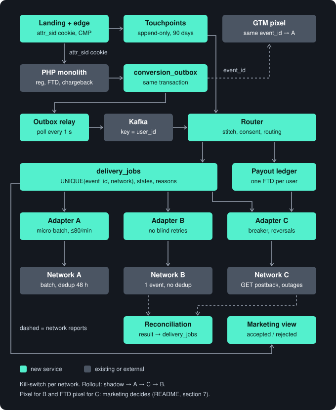
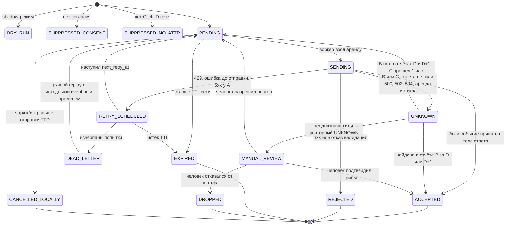

# Серверный подсчёт конверсий
## Харнес: для кого и как пользоваться

Репозиторий - не только решение, но и стартовая точка для команды, которая продолжит работу с AI-агентом (Claude Code и другими агентами, читающими `AGENTS.md`). Харнес - набор правил и режимов, который заставляет агента работать одинаково для всех и не выдумывать факты.

**Для кого**
- **Разработчики** команды marketing dev и подрядчики: дизайн-документы, решения, проверка допущений, ревью рискованных изменений, в том числе AI-кода и кода в чужих репозиториях.
- **Руководители и тимлиды маркетинга** (через лида команды): разбор входящих запросов, черновики сообщений в общий чат, разбор метрик пользы команды.

**Как пользоваться**
1. Откройте репозиторий в Claude Code. Правила из [AGENTS.md](AGENTS.md) подключаются автоматически через `CLAUDE.md`.
2. Вызовите нужный режим командой `/mdt <режим>`. Без аргумента `/mdt` покажет меню.

   | Команда | Что делает |
   |---|---|
   | `/mdt rfc` | Черновик дизайн-документа на ревью |
   | `/mdt adr` | Записать одно принятое решение в `docs/decisions/` |
   | `/mdt assumptions` | Проверить и занести утверждения в [реестр допущений](docs/assumptions.md) |
   | `/mdt review-ai-code` | Оценить риск изменения и что требует ручного ревью |
   | `/mdt intake` | Разобрать новые запросы и предложить порядок |
   | `/mdt stakeholder-msg` | Черновик сообщения стейкхолдерам (агент сам не отправляет) |
   | `/mdt metrics` | Разобрать, приносит ли команда пользу |

3. Проектные факты меняйте в `modes/_profile.md` и `config/project.yml`, правила работы команды - в `modes/_custom.md`. Системные файлы (`AGENTS.md`, `modes/_shared.md`, остальные режимы) проектных фактов не содержат и могут обновляться целиком. Подробности - в [DATA_CONTRACT.md](DATA_CONTRACT.md).

**Что гарантирует харнес**
- Факты берутся только из первичных источников: `docs/task.md`, конфиг, профиль, принятые ADR, подтверждённые допущения. Всё из AI-исследований и собственные предложения агента помечены и попадают в реестр допущений.
- Непроверенное утверждение агент не спрашивает «да/нет», а предлагает четыре исхода: верно, исправить значение, это не факт, «не знаю» (последний - навсегда).
- Агент ничего не отправляет, не публикует и не мёржит сам: он готовит черновик и останавливается.
- Изменения в чужих кодовых базах оформляются как предложение мейнтейнерам.

---

> Тестовое задание *Lead Full-stack Marketing Engineer*, Task 1 («Systems design»). Условие: [docs/task.md](docs/task.md).
> Статус: **черновик на ревью**. Ничего не отправлено и не опубликовано. Task 2 (менеджерские ситуации) - в [части 2](#часть-2-менеджерские-ситуации).

**Как читать пометки.** Цифры и ограничения из задания - первичные факты (`task.md`). Всё остальное помечено ссылкой на [реестр допущений](docs/assumptions.md) (`A-NNN`):
- `derived-unverified` - взято из AI-исследований и не проверено;
- `design-decision` - моё предложение, а не факт; ждёт решения ревьюера.

Ни одно допущение ещё не подтверждено. Ссылки на документацию в разделе 12 я **не открывал**: это ориентиры для проверки.

---

## 1. Контекст и проблема

Маркетинг покупает трафик в трёх сетях. Регистрации и первые пополнения сейчас уходят в сети только пикселями GTM, и по оценке маркетинга теряется 20–40% событий: блокировщики, ограничения браузеров, переходы между зеркалами. Из-за этого сети хуже обучают ставки, а партнёру C мы недоплачиваем или спорим о цифрах.

Ядро - PHP-монолит (MariaDB, Redis, Kafka). Click ID оно не хранит и не знает, откуда пришёл пользователь. Менять его можно, но чем меньше, тем лучше. Фронтенд и лендинги можно менять как угодно.

Сети устроены по-разному (всё из `task.md`):

| | A - реклама | B - реклама | C - партнёрка |
|---|---|---|---|
| API | REST, батч до 1000, 100 запр/мин | 1 событие на запрос | GET-постбэк с `click_id` и суммой |
| Дубли | убирает дубли с пикселем по `event_id` в окне 48 ч | не убирает: повтор = двойная конверсия | платим за каждое первое пополнение |
| Сбои | отклоняет события старше 7 дней | часто таймаут при уже принятом событии | эндпоинт лежит часами |
| Отчёты | - | отчёт о принятых раз в сутки | выгрузка партнёра раз в месяц |
| Особое | email только как SHA-256 | - | при чарджбэке нужна отмена |

## 2. Цели, не-цели, анти-цели

**Цели**
- Регистрация и первое пополнение доходят до сетей с сервера за ≤ 15 минут; отмена при чарджбэке доходит до C.
- Ни одного дубля там, где он дорог: в B (переобучение ставок) и в C (двойная выплата).
- Маркетинг видит по каждой сети: отправлено, принято, отклонено и почему.
- Минимальные и понятные мейнтейнерам правки монолита.

**Не-цели**
- Не заменяем GTM и не убираем пиксели целиком.
- Не строим CDP и мультиканальную аналитику.
- Не склеиваем анонимных пользователей между зеркалами фингерпринтингом.

**Анти-цели (провал, даже если «работает»)**
- Тихое удвоение конверсий, из-за которого ROAS выглядит лучше реального.
- Отправка данных пользователя без согласия.
- Двойная выплата партнёру или пропущенная отмена.
- Дашборд «100% успеха», потому что HTTP 200 приняли за принятие каждого события.

## 3. Нагрузка

Источник: `task.md` (50 000 регистраций + 5 000 первых пополнений в сутки, пики ×5), арифметика моя.

| Поток | В среднем | Пик ×5 |
|---|---|---|
| Все события (55 000/сут) | 0,64 событий/с (38/мин) | 3,2 событий/с (191/мин) |
| Первые пополнения (для C) | 0,06/с | 0,3/с |

- **A:** по одному событию на запрос на пике вышло бы ≈ 191 запр/мин при лимите 100, поэтому **батчинг обязателен**. Микробатч раз в 5 с даёт ≤ 12 запр/мин и ≤ 16 событий в батче.
- **B:** ≤ 3,2 запр/с даже если все события пойдут в B.
- **C:** доли запроса в секунду.

Это задача не про объём, а про идемпотентность, состояния и сверку. Новый кластер не нужен: хватит существующих Kafka, MariaDB и Redis. Новые элементы - небольшой сервис, обработчик на краю (reverse proxy), статические исходящие IP для C и витрина в BI.

## 4. Рассмотренные варианты

| Вариант | Плюсы | Минусы | Итог |
|---|---|---|---|
| **1. Готовое решение** (server-side GTM, SaaS-шлюзы) | Быстрый запуск для типовых сетей вроде A | Не умеет «не повторять после таймаута + сверка» для B, леджер выплат и отмены для C. Данные пользователей идут через третью сторону | Отклонён как основа. Позже можно оставить его для верхней части воронки |
| **2. Монолит сам шлёт в сети** | Нет нового сервиса | Монолит узнаёт про сети, ретраи и таймауты внутри PHP-FPM, правки большие. Противоречит «чем меньше изменений, тем лучше» | Отклонён |
| **3. Outbox в монолите + отдельный сервис доставки** | Монолит не знает про сети; транзакционная гарантия; вся сложность сетей - в одном месте | Новый сервис и его эксплуатация | **Выбран** |

Внутри варианта 3 отклонены ещё два способа достать события из монолита:
- **Прямой продюсер Kafka из PHP.** Это двойная запись: коммит прошёл, а сообщение потерялось, или наоборот - партнёру уходит выплата за откатившуюся транзакцию.
- **Debezium по binlog.** Требует Kafka Connect, ROW-binlog и историю схем ради < 10 событий/с.

## 5. Решение



### 5.1 Изменения в монолите (предложение для мейнтейнеров)

Монолит не знает про сети. Полный список правок (A-008, `design-decision`):

1. **Таблица `conversion_outbox`** (схема - в разделе 6).
2. **Один `INSERT` в существующих транзакциях** регистрации, подтверждения первого пополнения и чарджбэка. `event_id` детерминирован: `reg_<user_id>`, `ftd_<deposit_id>`, `cb_<chargeback_id>`.
3. **В payload - `email_sha256`** = SHA-256 от `lowercase(trim(email))`. Сырой email не покидает базу монолита. Других персональных данных сети по заданию не требуют.
4. **Принять cookie `attr_sid`** (непрозрачная строка) и положить её в строку outbox.
5. **Отдать фронту `user_id` и `deposit_id`**, если API их ещё не возвращает: из них фронт строит тот же `event_id` для пикселя.

Чего монолит не делает: не хранит Click ID, не знает согласий, не ходит по HTTP наружу, не знает правил сетей. Если он уже публикует события регистрации, пополнения и чарджбэка в Kafka и их можно дополнить `attr_sid` и `email_sha256`, таблица outbox не нужна.

Откат: таблица и INSERT безвредны, когда сервис доставки выключен. Строки старше 14 дней удаляются по расписанию.

### 5.2 Атрибуция, зеркала, `event_id` и пиксель

- **Захват на краю.** Click ID читает обработчик на reverse proxy лендинга при первом запросе к входному зеркалу, до любых редиректов. Он ставит `attr_sid` заголовком `Set-Cookie` с собственного IP-блока: cookie из JS и с чужого CNAME/IP Safari ограничивает 7 днями (A-010, A-011).
- **Согласие (A-012, `design-decision`).** Для EEA/UK ничего не сохраняем и cookie не ставим, пока пользователь не дал согласие в CMP. После согласия фронт отправляет Click ID из текущего URL в обработчик на краю. Кто уйдёт, не дав согласия, - сознательная потеря. Для остальных регионов захват идёт сразу. Окончательное правило - за юристами.
- **Хранение.** Касания пишутся в `attribution_touchpoints`: append-only, TTL 90 дней, значения регистрозависимы. Там же хранится последнее состояние согласия для `attr_sid`.
- **Зеркала.** Ссылки и редиректы между зеркалами декорируются подписанным токеном с коротким TTL (`?_as=sid.exp.HMAC`). Целевое зеркало проверяет подпись и ставит свой `attr_sid`.
- **После регистрации** атрибуция привязана к `user_id`: пополнения с любого устройства и зеркала атрибутируются без cookie.
- **Что не решается:** аноним пришёл по рекламе на зеркало 1, а через день сам открыл зеркало 2. Это известная потеря.
- **`event_id` в пикселе и на сервере совпадает до символа** (A-009). FTD-пиксель должен срабатывать после подтверждения пополнения, а не при попытке. Иначе пиксель шлёт конверсии, которых на сервере нет вовсе, и сравнение «сервер / пиксель» врёт.

### 5.3 Маршрутизация и доставка

- **Relay** раз в секунду читает новые строки outbox и публикует их в Kafka с ключом `user_id`, чтобы сохранить порядок регистрация → пополнение → чарджбэк.
- **Router** склеивает `attr_sid` с `user_id`, берёт последнее согласие и выбирает сеть. Событие уходит **только в сеть, чей Click ID стоит в атрибуции** (A-001, `design-decision`).

  Альтернатива из исследования Gemini - слать в A и B события всех пользователей с хэшем email. Это даёт сети больше данных для сопоставления ценой большего объёма передаваемых данных. Решает маркетинг вместе с юристами.

  Если согласие неизвестно (пополнение с другого устройства до склейки), для EEA/UK событие подавляется.
- **Доставка:** at-least-once из Kafka и идемпотентная вставка в `delivery_jobs` с `UNIQUE(event_id, network_id)`. Exactly-once в Kafka не помогает: внешний HTTP не входит в её транзакцию.
- **Планировщик повторов - в MariaDB:** поля `next_retry_at` и `lease_until`, захват задач через `SELECT … FOR UPDATE SKIP LOCKED`. Это требует MariaDB ≥ 10.6; иначе захват делается через `UPDATE … WHERE status='PENDING'` с токеном аренды (A-016).
- **SLO:** время считается от `occurred_at` бизнес-события. Цель - ≤ 15 мин, рабочая цель - p99 < 5 мин. События B, досланные после сверки, нарушают SLO по построению и считаются отдельной метрикой.

Состояния одной пары «событие + сеть»:



Для A истёкшая аренда возвращает задачу в повтор (A-003). Для B и C она ведёт в `UNKNOWN`.

### 5.4 Адаптеры

| | **A** | **B** | **C** |
|---|---|---|---|
| Ключ идемпотентности | `event_id`, общий с пикселем; дедуп между серверными повторами - допущение A-003 | Нет. Только наш учёт | `txid` (A-006) + леджер выплат `UNIQUE(partner, user_id)` |
| Отправка | Микробатч 5 с или 100 событий; токен-бакет ≤ 80 запр/мин | 1 событие на запрос, пул 10–20, `connect=3 с`, `read=30 с` | GET, статические egress-IP, секретный токен (A-014) |
| Ошибка до отправки тела | Повтор | Повтор | Повтор |
| Нет ответа после отправки, 500/502/504 | Повтор батча в пределах 48 ч | `UNKNOWN`, без повтора до сверки | `UNKNOWN` → через 1 ч один повтор (A-017) |
| Ответ 200 | Разбираем тело по каждому событию; при 400 делим батч пополам (A-002) | `ACCEPTED` | `ACCEPTED`, сохраняем `conversion_id` партнёра |
| Сроки | Не шлём старше 6 д 23 ч; автоповтор ≤ 48 ч от события (окно дедупа), позже - только вручную | Сверка с отчётами за D и D+1 (A-019) | Повторы до 7 суток, потолок бэкоффа 30 мин, circuit breaker; дренаж ≤ 10 запр/с (A-015) |
| Сверка | Не нужна | Найдено → `ACCEPTED`; нет в обоих отчётах → один повтор; неоднозначно → `MANUAL_REVIEW` | Месячная выгрузка против леджера: нет у партнёра / лишнее у партнёра / дубль / сумма / неотменённый чарджбэк |
| Чарджбэк | - | - | FTD ещё не отправлен → отменяем оба локально. FTD в `UNKNOWN` или `ACCEPTED` → шлём отмену по `conversion_id` или `txid` (отмена неизвестного `txid` безвредна, A-006). После locking period - спор, не автоматика |

**Почему у C повтор, а у B нет.** У B неясный исход разрешает суточный отчёт. У C ближайшая проверка - через месяц. Ждать месяц значит недоплачивать партнёру и спорить, а именно эту проблему мы решаем. Редкий дубль у C ловится месячной сверкой по нашему леджеру и оспаривается с доказательствами.

**Цена правила для B.** Пусть `t` - доля таймаутов, `p` - вероятность, что запрос всё-таки принят. Слепой повтор даёт `t·p` дублей, запрет повтора - `t·(1−p)` событий, которые приходят через 1–2 суток. Пример `t = 5%`, `p = 0,7`: +3,5% дублей против 1,5% поздних событий (числа иллюстративные, A-013).

### 5.5 Витрина для маркетинга

Витрина поверх `delivery_jobs` в существующем BI: **день × сеть × тип события × статус**. Сквозной баланс: всего в БД → подавлено (согласие / нет Click ID) → отправлено → принято → в повторе или `UNKNOWN` → отклонено.

Причины записаны понятными кодами, а не HTTP-статусами: `NO_CONSENT`, `NO_CLICK_ID`, `EVENT_TOO_OLD`, `INVALID_PII`, `NETWORK_REJECTED`, `TIMEOUT_UNKNOWN`, `LATE_AFTER_RECON`, `POST_LOCK_CHARGEBACK`, `AUTH_ERROR`.

Контрольные отношения:
- «принято сетью / в БД» - рост выше 1,05 означает дубли;
- «сервер / пиксель» - честно сопоставимо только после правки FTD-пикселя (5.2).

### 5.6 Приватность

- Согласие проверяется дважды: при захвате (5.2) и в Router перед отправкой. При отсутствии согласия для EEA/UK - fail-closed.
- Хэш email - тоже персональные данные. Нужны согласие и DPA с каждой сетью (A-012).
- Сырые email не попадают ни в Kafka, ни в логи. В исходящие URL и параметры не попадают персональные данные, остатки на счёте, KYC-статусы; URL проходят allowlist-санитайзер.
- Пополнение баланса может означать финансы или азартные игры - у рекламных площадок для этих вертикалей свои правила. **Это флаг для юристов.**

## 6. Предполагаемые контракты API

Всё в этом разделе - предположения (A-018). Реальные схемы нужно получить у сетей и мейнтейнеров.

**Outbox в монолите**
```sql
CREATE TABLE conversion_outbox (
  id            BIGINT UNSIGNED AUTO_INCREMENT PRIMARY KEY,
  event_id      VARCHAR(64) NOT NULL UNIQUE,   -- reg_<user_id> | ftd_<deposit_id> | cb_<chargeback_id>
  event_type    ENUM('registration','first_deposit','chargeback') NOT NULL,
  user_id       BIGINT UNSIGNED NOT NULL,
  attr_sid      CHAR(36) NULL,
  occurred_at   DATETIME(3) NOT NULL,          -- UTC
  payload_json  JSON NOT NULL,                 -- amount_minor, currency, email_sha256, related_deposit_id
  published_at  DATETIME(3) NULL,
  KEY idx_unpublished (published_at, id)
);
```

**Захват на краю.** Первый запрос на reverse proxy лендинга:
- обработчик читает `gclid`, `fbclid`, `click_id` и другие параметры, пишет касание и отвечает `Set-Cookie: attr_sid=<uuid>; HttpOnly; Secure; SameSite=Lax; Max-Age=7776000`;
- для EEA/UK вместо этого после согласия: `POST /_attr/capture {"click_params": {...}, "consent": {...}, "landing_url": "..."}` → тот же `Set-Cookie`.

**Сеть A**
```
POST /v1/events
{"events":[{"event_id":"ftd_123","event_name":"first_deposit","event_time":1763650000,
  "click_id":"...","user":{"email_sha256":"..."},"value":50.00,"currency":"EUR"}]}
→ 200 {"results":[{"event_id":"ftd_123","status":"accepted|rejected","reason":"..."}]}
→ 429 Retry-After: <сек>
```

**Сеть B**
```
POST /conversion {"click_id":"...","type":"registration","ts":1763650000,"amount":null,"ref":"reg_42"}
→ 200 {"status":"ok"}
Отчёт раз в сутки (CSV): date, click_id, type, ts, amount[, ref]
```

**Сеть C**
```
GET /postback?click_id=...&txid=ftd_123&amount=50.00&currency=EUR&status=approved&token=...
→ 200 {"conversion_id":"..."}
Отмена: тот же URL со status=reversed и тем же txid (или conversion_id)
Выгрузка раз в месяц (CSV): click_id, txid, amount, currency, status
```

## 7. Развилки, где решают люди

1. **Пиксель B при условии «пиксели остаются»** (A-005). B не убирает дубли, поэтому пиксель + сервер = двойная конверсия. Варианты:
   - (a) **Только сервер для Reg и FTD у B** - рекомендую: свежие данные, нет дублей. Но это нарушает «пиксели остаются» для B.
   - (b) **Пиксель остаётся, сервер досылает** только то, чего нет в суточном отчёте B. Дублей нет, условие выполнено, но досланное приходит через сутки и нарушает 15 минут.
   - (c) Пиксель + сервер сразу - недопустимо.
2. **FTD-пиксель для C.** Выплата идёт за каждое FTD. Пока партнёр не подтвердил дедупликацию пикселя и S2S, FTD-пиксель для C выключается.
3. **Модель атрибуции для C** - Last Non-Direct Paid Click в окне 30 дней или иная по контракту (A-007).
4. **Какие события получают A и B:** только атрибутированные или все с хэшем email (A-001).
5. **Захват до согласия для EEA/UK** (A-012) - решение юристов.
6. **Правки в монолите** (5.1) - аппрув мейнтейнеров.

## 8. Выкат

1. **Shadow (1–2 недели).** Захват и outbox включены, сервис пишет `DRY_RUN`, наружу ничего не уходит. Проверяем покрытие Click ID и 100% совпадение `event_id` между dataLayer и outbox.
2. **A:** тестовый режим сети (выключен в проде) → канарейка на части кампаний → 100%. Через 48–72 ч смотрим дедупликацию.
3. **C:** тестовые FTD и отмена с аккаунт-менеджером; при включении - решение по FTD-пикселю (раздел 7).
4. **B:** после решения по пикселю, сначала на малой доле. Критерий успеха - первая сверка за D и D+1.
5. **У каждой сети kill-switch:** исходящие запросы останавливаются, события копятся в `PENDING`. Replay сохраняет исходные `event_id` и время; события старше TTL отсекаются.

## 9. Риски

| Риск | Как обнаруживаем и снижаем |
|---|---|
| Двойной учёт после запуска (разные `event_id`, забытый тег) | Алерт «принято сетью / в БД > 1,05»; проверка в кабинете сети |
| Старое событие валит батч A | Фильтр по возрасту до упаковки; деление батча пополам при 400 |
| Отправка без согласия | Fail-closed на двух уровнях; метрика «0 событий с отказом в согласии» |
| Потерянная отмена для C | `отмены отправлены / чарджбэки = 100%` для трафика C; месячная сверка |
| C лежит часами | Circuit breaker, алерты через 2 ч и 6 ч, дренаж после восстановления |
| Отстал relay, растёт outbox | Алерт на возраст старейшей неопубликованной строки > 1 мин |
| Расхождение часов и часовых поясов | Везде UTC; сверка B по двум суткам; допуск ±24 ч в сверке C |
| Спор об атрибуции с C | Append-only история касаний и HTTP-попыток - доказательная база |
| Просроченный токен сети | Мгновенный алерт на 401/403 |

## 10. Открытые вопросы

1. Возвращает ли A статус по каждому событию и убирает ли дубли между серверными повторами? Есть ли тестовый режим? (A-002, A-003)
2. Что в суточном отчёте B: наш ID или только агрегаты? (A-004)
3. Поддерживает ли C `txid` и отмену? Каков locking period? (A-006, A-015)
4. Какие гео и вертикаль? (A-012)
5. Контролируем ли мы все зеркала, их DNS и CDN? (A-010)
6. Какая версия MariaDB? (A-016)

## 11. Допущения

Полный список - [docs/assumptions.md](docs/assumptions.md), A-001…A-019. Все `open`: ни одно не прошло подтверждение. Допущения части 2 записаны в самом разделе, а не в реестре.

## 12. Исследования и источники

В `docs/` лежат три AI-исследования (они перечислены в `config/project.yml`, `sources.derived`). Всё, что взято из них, помечено.

| | [Claude](docs/claude-deep-research.md) | [OpenAI](docs/open-ai-deep-research.md) | [Gemini](docs/Server-Side%20Conversion%20Tracking-Gemini.pdf) |
|---|---|---|---|
| Решает кейс A/B/C | Да, псевдокод и схема данных | **Нет** - принял A, B, C за три компании разного размера | Да, самое подробное |
| Ссылки на источники | Нет ни одной | Нет, хотя в конце заявлено «каждый факт подтверждён цитатой» | Есть, но много SEO-блогов вендоров; источник №6 - `unknown_url`, им подписан собственный расчёт Gemini |
| Главные проблемы | Сверка B без учёта границы суток; ключ леджера C `(click_id, event_type)` слабее, чем по `user_id` | Двойная запись PHP → Kafka и Redis; устаревшее «Chrome отключит сторонние cookie»; сомнительные цифры производительности | Много утверждений о событиях конца 2026 года, которые я не проверял; коэффициент ×3 и порог `0,99` взяты с потолка; сверка B без учёта границы суток |
| Что взято | «Не повторять при read-timeout у B», три исхода сверки, коды причин | Только общий чек-лист приватности | Cookie с собственного IP, подписанный токен для зеркал, детерминированный `event_id`, аренда задач, деление батча, раздельные таймауты, отмена по `conversion_id`, предупреждение о дублях пикселя у B и C |

Gemini сознательно предлагает слать в A и B события всех пользователей. Я выбрал другое (A-001), но это развилка, а не ошибка исследования.

В версиях Gemini (PDF и DOCX) диаграммы остались исходным кодом, а форматы `_fbc` и `_fbp` набраны формулами, поэтому выглядят искажёнными. Содержание при этом верное.

**Официальная документация - ориентиры для проверки, я их не открывал (ссылки из списка источников Gemini, дата обращения не проверена):**
- Safari ITP: https://webkit.org/tracking-prevention/ (A-011)
- Дедупликация пикселя и CAPI у Meta - аналог сети A: https://developers.facebook.com/documentation/ads-commerce/conversions-api/deduplicate-pixel-and-server-events.md (A-003)
- Отмены в партнёрской платформе Everflow - аналог сети C: https://helpdesk.everflow.io/customer/reversal-postback-setup-for-processing-canceled-transactions (A-006)
- Firefox Enhanced Tracking Protection: https://support.mozilla.org/en-US/kb/enhanced-tracking-protection-firefox-desktop
- Debezium для MariaDB (отклонённая альтернатива): https://docs.confluent.io/cloud/current/connectors/cc-mariadb-cdc-source-debezium.html

---

# Часть 2. Менеджерские ситуации

Контекст (из `task.md`): я - lead product engineer в новой marketing dev team; в команде я и один senior; стейкхолдеры - тимлиды маркетинга (influence, cold, SMM и др.); рядом четыре подрядчика и ещё десяток сменных; компания переходит на разработку с AI-агентами. Позиции ниже - мои, как автора; допущения указаны прямо в ответах.

## Вопрос 1. Три запроса в один день

> Лендинг под ивент со стримером к пятнице; интеграция с новой партнёрской сетью, иначе сорвётся контракт; переделка блога под SEO. Команда в это время закрывает уязвимости. Как устроить приём запросов и приоритизацию? Напишите сообщение в общий чат.

### Ответ

Порядок задаю по цене задержки. Первое - уязвимости: если они реальные и несут репутационный риск или риск для данных, команда переключается на них, и это вытесняет любую задачу. Второе - интеграция с партнёрской сетью: сначала спрашиваем сеть, можно ли сдвинуть срок, пока мы чиним уязвимости; если нельзя, интеграция идёт сразу после уязвимостей, потому что иначе теряем контракт. Лендинг дату не сдвигает: делаем простую версию без сложной анимации параллельно, с помощью агента, и улучшаем, если останется время. SEO-блог последний: его эффект растёт неделями и не зависит от нашей скорости.

Запросы принимаю из любых каналов, но веду их в одном месте: Jira-доска с карточками (кто просит, что именно, к какой дате, что теряем при сдвиге), видимая всем заказчикам. Порядок и ёмкость предлагаю я как лид и объясняю его в общем чате; если тимлиды не согласны, решаем по тому, что именно теряется.

### Сообщение в общий чат (черновик, не отправлено)

> Коллеги, привет! Пришли три запроса, предлагаю такой порядок.
>
> 1. **Уязвимости.** Сейчас проверяем, насколько они серьёзны. Если есть риск для данных или репутации, переключаемся на них в первую очередь.
> 2. **Интеграция с новой сетью.** [Имя], можем ли мы попросить сеть сдвинуть срок, пока чиним уязвимости? Если нет, берём интеграцию сразу после них: контракт терять нельзя. Нужна дата и контакт со стороны сети.
> 3. **Лендинг к пятнице.** Дату не двигаем. Делаем простую версию без сложной анимации, параллельно; доработаем, если останется время. Нужны тексты, макет и время стрима.
> 4. **SEO-блог.** Берём после этих задач: эффект от SEO растёт неделями, и пара недель ожидания почти ничего не стоит. Пришлите, пожалуйста, цель и метрику.
>
> Если порядок что-то ломает, напишите в течение рабочего дня, что именно теряется. Все запросы и статусы будут на общей Jira-доске, ссылку пришлю сюда.

## Вопрос 2. Два инцидента из-за непроверенного AI-кода подрядчика

> Два инцидента подряд случились из-за непроверенного AI-кода, который подрядчик выкатил в своём проекте. Но тимлиды маркетинга им довольны больше всего, потому что он делает их запросы быстрее всех. Что делать? Как выстроить работу с ним на ближайшие два месяца и как понять, что стало лучше?

### Ответ

Сразу откатываю код, который подрядчик выкатил без проверки, и держу его откаченным, пока не поймём, что произошло и какие там уязвимости: мы не можем строить решения на неизвестности того, что едет в продакшен. Риск для репутации, клиентов и данных перевешивает скорость, тем более что неизвестно, какие именно задачи подрядчик делает быстрее. Корень проблемы не в человеке, а в культуре работы с AI: почему вывод агента попал в продакшен без анализа и тестов. Это тема для ретроспективы или отдельного звонка с подрядчиком и тимлидами.

На два месяца: каждый выпуск проходит ревью человека, который знает историю проекта и чувствительные данные, плюс LLM as judge как дополнительный слой; решение о выпуске за человеком. Вводим уровни риска: мелкие правки лендингов идут быстро, всё, что касается данных, платежей и авторизации, только после нашего ревью; в CI обязательные проверки на уязвимости, секреты и тесты. Самостоятельность возвращаем постепенно там, где проверки стабильно проходят. Что стало лучше, видно по трём вещам: инцидентов и откатов меньше, все чувствительные изменения проходят ревью, а скорость по простым задачам для маркетинга не упала.

## Вопрос 3. Как понять, что команда приносит пользу

> Как в конце испытательного срока понять, что команда приносит пользу маркетингу, а не просто закрывает задачи? Какие 3-5 метрик разбирать регулярно, на что ещё обратить внимание?

### Ответ

Закрытые задачи и число релизов показывают активность, а не пользу. Точка отсчёта у нас есть: маркетинг оценивает потери пикселей в 20-40% событий. Это оценка, поэтому сначала измеряем реальный базовый уровень и дальше смотрим, насколько он сдвинулся. Раз в неделю разбираю четыре метрики:
1. **Охват конверсий:** какая доля подтверждённых в базе регистраций и пополнений дошла до сетей, в сравнении с тем, что видят GTM и Google Analytics.
2. **Свежесть:** доля событий, доставленных за 15 минут.
3. **Дубли и расхождения:** лишние конверсии в сетях и спорные выплаты партнёру C.
4. **Надёжность:** ошибки, задержки и инциденты по данным New Relic или CloudWatch.

Кроме чисел смотрю на то, что говорят тимлиды маркетинга, на то, есть ли у каждого запроса заранее названная цель, и на повторяющиеся причины сбоев: если одни и те же проблемы возвращаются, мы закрываем симптомы, а не приносим пользу. Целевые значения согласуем с маркетингом после первого замера.

## Вопрос 4. Агенты в своей и в чужой кодовой базе

> Как адаптируешься под запрос, что с агентами нужно делать код и в своей кодовой базе, и в чужой, где мейнтейнеры из других команд?

### Ответ

Параллельно настраиваю харнес (правила и границы для агента, как в этом репозитории) и нахожу людей с историческим знанием проекта. Работаю через spec-driven development: спецификация, план, потом pull request. Несколько задач веду параллельно разными агентами, но одну задачу не дроблю между агентами. Результат проверяю человеком и LLM as judge, причём разными моделями и инструментами, потому что модель склонна предпочитать собственный вывод (self-preference bias). Решение о выпуске всегда за человеком.

В чужой кодовой базе изменение - это предложение мейнтейнерам, а не наше решение: работаем по их правилам и процессу ревью, присылаем маленький согласованный pull request, а отвечает за него человек-автор. Можно ли добавлять туда общие артефакты для агентов (`CLAUDE.md`, `AGENTS.md`, навыки), решают мейнтейнеры. Если будет ресурс, предложу команде общий харнес и spec-driven development как пилот: одинаковые правила снижают риск ошибок агента и искажения запросов по пути от заказчика к разработчику.
