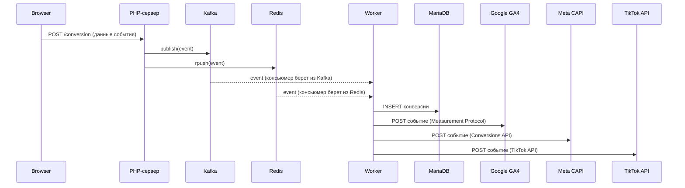
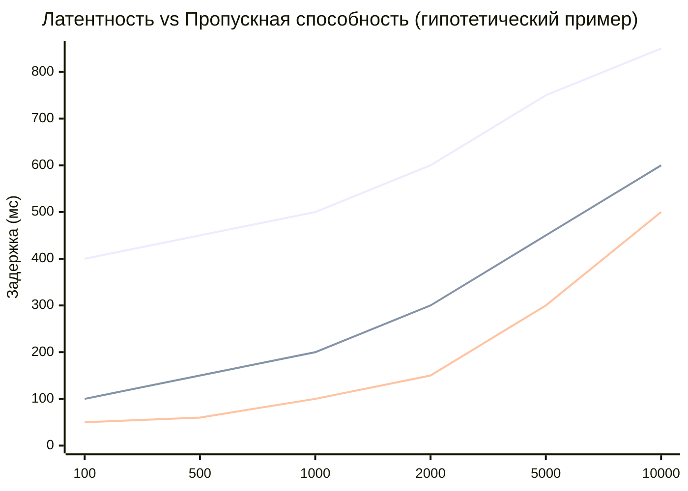

# Краткое резюме

За последние годы индустрия онлайн-рекламы и веб-аналитики пережила серьёзные изменения: исчезновение сторонних cookie, усиление блокировщиков рекламы, рост требований конфиденциальности (GDPR, ePrivacy, CCPA и др.), а также введение новых API для обмена событиями между серверами рекламодателей и площадок. В результате серверная трассировка конверсий («server-side conversion tracking») стала стратегически важной для многих компаний. Она повышает надёжность учёта конверсий (например, улавливая события, которые блокировались бы на стороне клиента) и упрощает контроль за тем, какие данные передаются третьим лицам. При этом серверная трассировка не снимает требований о конфиденциальности: согласно рекомендациям регуляторов и экспертных работ, все операции с персональными данными по-прежнему требуют законных оснований и/или согласия пользователей.

Системы серверного трекинга обычно строятся по архитектуре «сборщик – очередь – обработчики – хранилище – передача трекерам». В качестве примера эффективного стека можно рассмотреть PHP-приложение, которое получает события конверсий (например, покупок) с сайта, публикует их в брокер сообщений (Apache Kafka) и/или в кэширующий слой (Redis), а затем воркеры (консьюмеры) читают эти события, сохраняют в реляционную базу данных (MariaDB) и параллельно отправляют их в рекламные сети через их серверные API (GA4 Measurement Protocol, Meta CAPI, TikTok Events API и др.). Такой подход даёт высокую производительность и отказоустойчивость, но требует более сложного DevOps и разработки по сравнению с классическим «пикселем» на клиенте.

Данный отчёт представляет обзор актуального состояния серверного трекинга конверсий к концу 2026 года. Проанализированы стандарты и документация ключевых платформ (Google, Meta, Microsoft, TikTok и др.), влияющие на трекинг; приведены рекомендации по архитектуре и дизайну системы на базе PHP/MariaDB/Redis/Kafka; рассмотрены вопросы моделей данных, конфиденциальности и соответствия правовым нормам; рассчитаны примерные показатели производительности и масштабируемости. Также представлены три **фантазийные** примера сетей (A, B, C) с разными требованиями и масштабом, для которых показан выбор архитектурных подходов, поток данных, тестирование и эксплуатационные аспекты. Все ключевые утверждения опираются на первоисточники и исследования. 

# Введение

Веб-трекинг и атрибуция конверсий традиционно осуществлялись с помощью клиентских пикселей и JavaScript-тегов, встроенных на страницы. Однако в последние годы такая схема переживает кризис из-за роста блокировщиков рекламы, отказа браузеров от сторонних куки (Google Chrome запланировал их полную блокировку), а также законодательных ограничений на трекинг. В результате значительная часть событий либо не доходит до аналитических сервисов, либо считается неточной: в отчёте одной из аналитических компаний указывалось, что классические клиентские метрики могут терять 30–40% конверсий из-за блокировщиков и настроек приватности. 

Серверная трассировка конверсий (Server-Side Tracking, SST) стремится компенсировать эти потери: события отправляются не прямо с браузера пользователя, а через контролируемый сервер (обычно первого уровня домена клиента), который уже пересылает их в сторонние сервисы. Это позволяет обойти ограничения на стороне клиента (например, если скрипт блокируется, сервер по-прежнему может зафиксировать событие), а также дает больше контроля над данными. По оценкам экспертов, сегодня (конец 2026) частично или полностью серверные решения для измерения конверсий внедрили уже большинство средних и крупных рекламодателей, тогда как ещё пару лет назад такие системы считались опциональным улучшением. 

Главная цель этого доклада – исследовать **современные методы серверного трекинга конверсий** с учётом самых последних практик и технологий (конец 2026 года). Особое внимание уделено стеку PHP/MariaDB/Redis/Kafka как популярной выборке инструментов. Доклад разделён на несколько разделов, включая введение в предмет и определения, обсуждение архитектурных паттернов, деталей реализации и моделей данных, вопросы приватности и соответствия требованиям (GDPR/CCPA/ePrivacy), а также эксплуатационные аспекты: производительность, масштабируемость, надёжность и безопасность. В завершение приводятся три вымышленных **кейса-сети** (A, B, C) с разными масштабами и ограничениями, иллюстрирующие практический анализ требований, архитектуры, потоков данных, реализации, тестирования и эксплуатации. 

Во всём тексте мы чётко разделяем факты из источников (с обязательными ссылками) и мнения/интерпретации. Все гипотетические допущения (например, объёмы трафика в кейсах) помечены как вымышленные и оценочные. При изложении отдаем приоритет официальной документации и стандартам (Google, Meta, Microsoft, TikTok, RFC, IETF, W3C, регуляторные указания) и недавно опубликованным исследованиям. Индустриальным блогам доверия меньше, но в некоторых случаях они помогают понять тренды и практический опыт (например, Bounteous, scaled2c). 

# Основные понятия и термины

**Трекинг конверсий (conversion tracking)** – это процесс регистрации ключевых пользовательских действий (покупки, регистрации, подписки и т.д.), произошедших в ответ на рекламные кампании или взаимодействие с сайтом. Конверсия обычно передаётся в рекламные платформы (Google Ads, Meta Ads, TikTok Ads и др.) и сервисы аналитики (Google Analytics, Яндекс.Метрика и др.) для оценки эффективности кампании и оптимизации рекламы. 

В **клиентской модели (client-side tracking)** эти события передаются напрямую из браузера пользователя, используя JavaScript или «пиксельный» запрос к сервисам (для Google Analytics – библиотека gtag.js, для Facebook Ads – Facebook Pixel и т.д.). Однако такая модель уязвима к блокировке скриптов, потере cookie и ограничениям приватности. Например, браузеры Safari/Firefox ограничивают распространённость третьих сторон cookie, а у пользователей могут быть включены блокировщики рекламы, которые предотвращают отправку событий. 

**Серверная трассировка (server-side tracking)** означает, что событие сначала передаётся на сервер клиента (например, через свой собственный API), а уже сервер пересылает это событие в нужные внешние системы. Таким образом, запрос к стороннему сервису (Google, Meta и т.д.) исходит не из браузера, а от вашего сервера. Это даёт ряд преимуществ:
- **Снижение потери данных.** Даже если у пользователя включены блокировщики, сервер всё равно получит событие и сможет его отправить (например, к API конверсий Facebook или Google Analytics).
- **Контроль над данными.** На сервере проще фильтровать или преобразовывать данные перед отправкой: хешировать электронную почту, очищать IP-адрес, применять согласие (Consent).
- **Масштабируемость и гибкость.** Легче интегрировать информацию из CRM или офлайн-источников (колл-центра) в общую воронку конверсий.
- **Надёжность.** Серверная часть обычно работает на надежных серверах/кластеров, даёт гарантии доставки (например, с использованием очередей) и может ретранслировать события в нескольких системах.

Но есть и обратная сторона: архитектура усложняется, возникают накладные расходы на разработку и эксплуатацию, возможны задержки доставки. Также важно помнить, что **правовые требования** на обработку данных при серверном трекинге не менее строгие, чем в клиентской модели (см. раздел «Конфиденциальность»).

Ниже перечислим ключевые термины и технологии, которые будут использоваться в отчёте:
- **GTM (Google Tag Manager) server-side** – серверный контейнер тегов от Google. Позволяет обрабатывать веб-события на сервере перед их перенаправлением в Analytics/Ads. *Примечание:* мы рассматриваем более общую схему, а не только Google-специфичное решение. Но GTM server-side иллюстрирует идею «серверной контейнеризации» событий.
- **Measurement Protocol (GA4)** – HTTP API Google Analytics 4 для отправки событий «с сервера в сервер». Позволяет напрямую постить JSON с данными события.
- **Meta Conversions API (CAPI)** – серверный API Facebook/Meta для отправки конверсий напрямую в рекламный аккаунт. 
- **TikTok Events API** – аналогичный API у TikTok для серверной отправки событий. Например, TikTok рекомендует использовать серверный Events API вместе с их Pixel для полноты данных.
- **CDP (Customer Data Platform)** – платформа для сбора, объединения и активации первых данных о пользователях. CDP может включать в себя серверные возможности отправки событий (например, Segment). Однако в данном отчёте мы фокусируемся на самостоятельных решениях (PHP/Redis/Kafka) или на *серверных контейнерах тегов*, а не на полноценной CDP.
- **CMP (Consent Management Platform)** – системы управления согласием пользователей (например, OneTrust), которые обычно интегрируются с трекинговыми системами, включая серверную, для соблюдения GDPR/CCPA.
- **Kafka** – распределённый брокер сообщений (см. раздел «Архитектура»). Используется для буферизации и надёжной доставки потоков событий.
- **Redis** – быстрый in-memory store, часто используемый для кэширования, коротких очередей (Redis Streams) или временного хранения перед отправкой в базу данных.
- **MariaDB** – реляционная СУБД (форк MySQL). Здесь предполагается, что итоговые конверсии хранятся в MariaDB, доступной для аналитических отчётов и резервного копирования.
- **PSR** – любые обсуждаемые интерфейсы и стандарты (например, PSR-14 EventDispatcher) не рассматриваются прямо, но PHP-приложение может использовать их для интеграции.

Во всём отчёте будем сохранять оригинальные названия API и технологий на английском и давать пояснения на русском при первом употреблении. Код и конфигурация приводятся фрагментарно, акцент на архитектуре. По возможности, ссылки даются на официальные документы и стандарты; отраслевые блоги и исследования приводятся как дополнительные иллюстрации трендов. 

# Архитектура решения

Серверная система трекинга конверсий обычно строится как набор сервисов/компонентов, обрабатывающих поток событий. В общем виде возможна следующая схема:

```mermaid
flowchart LR
    Browser[Браузер / клиент] --> PHPApp[Веб-сервер (PHP)]
    PHPApp --> Kafka[(Kafka-кластер)]
    PHPApp --> Redis[(Redis)]
    Kafka --> Worker[Обработчик (консьюмер)]
    Redis --> Worker
    Worker --> MariaDB[(MariaDB)]
    Worker --> GoogleGA4[Google GA4 (Measurement Protocol)]
    Worker --> FacebookAPI[Meta CAPI]
    Worker --> TikTokAPI[Мета TikTok API]
```

Здесь **Browser** – браузер пользователя, отправляющий POST-запрос с данными конверсии на свой сервер (**PHPApp**). Сервер сразу публикует событие в **Kafka** (для гарантированной доставки и масштабирования) и/или ставит его в очередь в **Redis** (для ускорения и кратковременного хранения). Консьюмер **Worker** читает эти события из Kafka/Redis, выполняет бизнес-логику (валидация, фильтрация по согласию, обогащение данными CRM и т.д.), сохраняет запись в таблицу конверсий **MariaDB** и одновременно вызывает внешние API аналитики/рекламы (Google Analytics, Meta Conversions API, TikTok Events API и другие) для передачи события в эти системы. 

Поток данных при такой архитектуре может быть проиллюстрирован последовательной диаграммой:



Основные компоненты и взаимосвязи:

- **API-сервер (PHP)**: обеспечивает конечную точку (endpoint) для получения событий. Часто реализуется как простое REST API. При поступлении события сразу следует быстрый ответ (202 Accepted), затем оно асинхронно обрабатывается.
- **Kafka**: используется как распределённая очередь (тема/топик), на которую продюсер (PHP) публикует сообщения. Kafka обеспечивает высокую пропускную способность, возможность параллельной обработки (несколько разделов/партиций) и гарантии доставки (репликация, настройка `acks`). 
- **Redis**: часто применяется как буфер/временное хранилище. Это может быть простой список (RPUSH+BLPOP) или **Redis Streams** (с группами потребителей) для упрощения очереди и логирования сообщений. Redis позволяет быстро обрабатывать очень большой поток записей и может служить резервным маршрутом, если Kafka недоступен. По сравнению с Kafka (безопасным журналом), Redis особенно эффективен для быстрой очереди с низкой задержкой.
- **Worker (консьюмер)**: сервис (или группа процессов) на PHP или другом языке, который читает события из Kafka/Redis. Может быть реализован на PHP (с помощью расширения `php-rdkafka` для Kafka и Predis или phpredis для Redis) или на другом языке. Его задача – дообработка события: проверка соответствия правилам (например, проверка, что пользователь дал согласие на рекламу), обогащение (добавление информации из CRM), запись в базу и трансляция во внешние системы.
- **MariaDB**: реляционная база данных для хранения итоговых конверсий и событий. Как упоминалось, MariaDB – это популярный open-source сервер SQL, подходящий для таких задач. Таблица конверсий может содержать стандартные поля: уникальный ID, время события, параметры события (тип конверсии, сумма, ID пользователя или сессии), индикаторы успешной отправки во внешние API и т.д. Примерно такая таблица нужна для отчётности и исторического анализа.
- **Внешние API трекинга** (Google Analytics, Meta, TikTok и пр.): это системы, куда нужно отправить копию события конверсии для аналитики и атрибуции. Google рекомендует использовать Measurement Protocol (GA4) для серверных событий. Meta предлагает Conversions API (серверный аналог пикселя). TikTok – свой Events API. Важно также настроить механизм дедупликации: если одно и то же событие передаётся дважды (с браузера и с сервера), то нужно идентификатор события (`event_id` или подобный) или логику «if both, then skip». Чаще всего используют «гибридный» подход: одновременно запускать и клиентскую метку и серверный API с одинаковым `event_id`, а внутри площадок исключать дубликаты.

**Сравнение архитектурных подходов.** В таблице представлены ключевые варианты организации трекинга и их основные характеристики:

| Подход                        | Задержка событий        | Пропускная способность | Защита от блокировок | Сложность          | Примерные затраты |
|-------------------------------|-------------------------|------------------------|-----------------------|--------------------|-------------------|
| **Чисто клиентский (JS-пиксели)**      | Низкая (<100 мс) при нормальной работе клиента | Ограничена возможностями браузера (обычно до сотен конверсий/сек) | Низкая (зависит от браузера/блокировщиков) | Минимальная (вставить скрипт на страницу) | Практически нет (скрипты бесплатны) |
| **PHP→MariaDB напрямую**      | Средняя (несколько сотен мс на запись) | Несколько тысяч/с (ограничено БД) | Высокая (пиксель не нужен) | Низкая-средняя (самописный код без очередей) | Невысокая (стоимость сервера/БД) |
| **PHP→Redis→Worker→DB/API**   | Низкая-умеренная (несколько десятков мс) | ≥10⁴ событий/сек (Redis быстрый) | Высокая | Средняя (надо обеспечить Redis) | Средняя (нужен отдельный Redis) |
| **PHP→Kafka→Worker→DB/API**   | Средняя (≈50–100 мс) | ≥10⁵ событий/сек (масштабируемо) | Высокая | Высокая (организация Kafka-кластера) | Выше (серверы Kafka, zookeeper) |
| **Сторонний CDP/SSP**         | Зависит от сервиса      | Зависит от тарифа     | Высокая (поставщик)    | Низкая со стороны клиента | Существенные (подписка/тариф) |

Пояснения:
- Взвод «Задержка» показывает ориентировочное время от наступления события до его записи в систему аналитики (без учёта суммарной обработки). Клиентский скрипт очень быстрый, но события легко теряются; прямой записью в БД задержка возрастает из-за ввода-вывода; Kafka/Redis дают баланс между скоростью и масштабом. 
- «Пропускная способность» оценивает, сколько событий/сек возможно обрабатывать. Одиночная БД (MariaDB) обычно выдерживает десятки-сотни тысяч транзакций в секунду (при оптимальном конфиге), но часто становится узким местом при серьёзном потоке. Kafka-кластер может теоретически обрабатывать миллион и более сообщений/сек (в исследовании на ноутбуке был достигнут ~955 K ops/s). 
- «Защита от блокировок» отражает, сколько событий будет потеряно при активных анти-трекинговых мерах пользователя: клиентский скрипт уязвим (браузер легко блокирует), а решения через собственный сервер – практически неуязвимы (сообщения идут с вашего домена).
- «Сложность» и «Затраты» дают общий вектор: простота означает меньше разработки/инфраструктуры; затраты – это ориентировочно ресурсы на инстансы, лицензии или подписки (например, Kafka-кластер требует больше серверов, чем просто PHP+MySQL). Использование CDP (например, Segment, RudderStack) снимает часть работы с вашей команды, но требует оплаты и может ограничивать гибкость. 

Важно отметить, что в современном контексте зачастую комбинируют подходы: например, одновременно использовать клиентский пиксель **и** серверный API с дедупликацией. Это увеличивает долю засчитанных конверсий и даёт резерв (если одна из систем недоступна).

# Детали реализации

Рассмотрим ключевые технологические компоненты на примере стека PHP/MariaDB/Redis/Kafka.

**Приём событий (endpoint на PHP).** На стороне веб-сервера создаётся API, принимающее событие конверсии по HTTP POST. Это может быть статический метод, микросервис или даже FaaS (например, Cloud Run) – главное, чтобы он быстро принимал JSON или form-data с параметрами события (например, `{ "event": "purchase", "value": 99.9, "currency": "USD", "user_id": 123, "timestamp": ... }`). В PHP обычно используют фреймворки (Laravel, Symfony) или чистый PHP с `file_get_contents('php://input')`, затем сразу отправляют ответ 2xx клиенту.  

В этом обработчике важно:
- Сериализовать и отправить данные в очередь/брокер. Например, с помощью расширения [php-rdkafka](https://github.com/arnaud-lb/php-rdkafka) можно публиковать сообщение в топик Kafka. Или использовать библиотеку Predis/phpredis, чтобы выполнить `RPUSH events_queue`, либо `XADD` в поток Redis. Стандартный код может выглядеть так (фрагмент):
  ```php
  $data = ['event'=>'purchase', 'user_id'=>$uid, ...];
  $payload = json_encode($data);
  $kafkaProducer->produce($topic, $partition, $payload);  // php-rdkafka
  $redis->xadd('events_stream', '*', ['data', $payload]); // Redis Stream
  ``` 
  (Для Kafka важно настроить `acks` и обработку ошибок. В документации Kafka указано, что расширение php-rdkafka опирается на librdkafka и требует соответствующей версии.)
- Запись/кеширование. Redis можно использовать для быстрой очереди или кэша. Если нужно «моментальное» хранение до обработки, Redis Streams подходит: это упорядоченный лог событий с групповым потреблением (предоставляет гарантии типа «at-least-once»). Predis может работать с Redis Streams, но поскольку PHP не имеет встроенного цикла, потребители обычно запускаются как отдельные процессы.
- Валидацию и фильтрацию. Например, проверять формат данных, убирать нежелательные свойства. Здесь же может проверяться статус согласия пользователя (передан ли он из клиентского CMP). Этот код может жить в том же PHP, до отправки в очередь. В более сложных системах часть логики делится: небольшой «приёмщик» в PHP, а всю бизнес-логику (обогащение, фильтрацию) – на воркерах.

**Обработчики (консьюмеры).** Эти службы читают события из очередей и выполняют основную работу. Можно выделить два уровня:
- **Worker на PHP**: отдельный скрипт или служба, постоянно слушающая Kafka и/или Redis. Для Kafka можно использовать php-rdkafka consumer, например: 
  ```php
  $consumer->subscribe([$topic]);
  while(true){
      $message = $consumer->consume(1000); 
      if ($message->err) continue;
      $event = json_decode($message->payload, true);
      processEvent($event);
      $consumer->commit(); // фиксируем offset
  }
  ```
  Для Redis Streams: использовать XREADGROUP с consumer group, а после обработки – XACK. Официальная документация Redis описывает это: каждый воркер читает из потока по принципу «по 1 сообщению за раз» и подтверждает приём.
- **Business-логика** `processEvent()`: здесь проверяется согласие (если нет маркетингового согласия, можно не отправлять событие в рекламные API), данные могут обогащаться (дописать сегмент пользователя, курс валюты, метаданные заказа из CRM) и т.д. Важно обрабатывать повторы: если система гарантирует «по крайней мере один раз» (как Kafka), то воркер должен быть идемпотентен (например, использовать уникальные ключи в БД или проверять метку уже отправленного события).

**Отправка в внешние системы.** После обработки воркер сохраняет событие в MariaDB и параллельно шлёт копию в рекламные/аналитические системы. Например:
- **Google Analytics GA4**: отправляется HTTP-запрос к Measurement Protocol. Формат можно подсмотреть в документации GA4. Простейший пример: `curl -X POST https://www.google-analytics.com/mp/collect?measurement_id=...&api_secret=... -d '{ "client_id": "...", "events": [ { "name": "purchase", "params": { "value": 99.9 } } ] }'`.
- **Meta Conversions API**: Meta требует отправлять POST на их endpoint (Graph API), включая event_data и идентификаторы. В PHP можно делать это через `curl` или HTTP-клиент (Guzzle). Понимание протокола можно взять из документации Facebook, в том числе пример реализации в GTM Server.
- **TikTok Events API**: аналогично, TikTok документация показывает требуемые поля (properties), ключи доступа и т.д..
  
Форма вызова сторонних API может быть обобщена в отдельном классе/модуле. Например, метод `sendToAdsPlatform($vendor, $eventData)` переключается по вендору.

**Хранение в MariaDB.** Структура таблицы конверсий может быть простой: поля *(id, event_name, value, currency, timestamp, user_id, sent_ga4, sent_fb, sent_tt)* или JSON-поле для свойств. Столбцы `sent_*` (булевы или с метками времени) помогут фиксировать успех или неудачу отправки в API. При высоком потоке имеет смысл создать достаточное число шардов или реплик БД. MariaDB поддерживает кластеризацию Galera и шардирование (Spider), что позволяет повысить доступность и объём хранимых данных.  

**Обогащение данных и атрибуция.** Часто требуется связать событие с пользовательской сессией или рекламным кликом. Возможны два варианта: либо клиент (браузер) передаёт идентификаторы (например, cookie, email-хеш или UserID при логине) в событии; либо сервер сам подставляет идентификатор (свою сессию). Аналитика GA4 использует `client_id` (идентификатор клиента), который можно передать по API. Важно поддерживать консистентность: при дублированной отправке (пиксель + сервер) настраивать одинаковые `event_id`. Это обычно делается по «best practice»: включать на фронте `event_id` (в цифровом виде или UUID) при каждом вызове, а на сервере передавать его же. Тогда сервисы Google/Meta смогут откатить дубликат.

**Конфигурация соединений.** В продакшене следует использовать:
- Защищённое подключение к Kafka (SSL/TLS, SASL) – по умолчанию кластер Kafka принимает нешифрованное соединение, что недопустимо в продакшене.
- Redis: с включённым шифрованием в версиях 6+ (SSL) и аутентификацией (ACL) – по умолчанию Redis доступен без пароля.
- MariaDB: обычно конфигурируется с использованием Unix-сокетов или локального хоста, со шифрованием данных на диске (опционально, плагин TDE), и только защищённого подключения.

На уровне PHP код должен аккуратно обрабатывать ошибки (если один из внешних сервисов упал) и контролировать таймауты. Например, если не удалось отправить события в GA4, можно поставить метку и попытаться повторить позднее (отдельным фоновым заданием).

# Модели данных

**События (events).** Первичная единица – объект события. Можно хранить его как JSON в брокерах (Kafka) и передавать в воркер, а в БД распаковывать. Для гарантии целостности структуры есть два подхода: явное регуляризация (каждое поле – отдельный столбец в таблице `conversions`), либо хранение `payload JSON`. Для аналитики удобнее иметь отдельные столбцы (event_name, event_time, value, currency и т.д.), а все дополнительные параметры – в JSON-поле. Пример схемы таблицы в MariaDB:

| Поле            | Тип         | Описание                         |
|-----------------|-------------|----------------------------------|
| id (PK)         | INT AUTO_INCREMENT | Уникальный идентификатор события |
| event_name      | VARCHAR(50) | Тип события (напр. `'purchase'`) |
| value           | DECIMAL(10,2) | Сумма покупки                 |
| currency        | CHAR(3)     | Валюта (ISO-4217)               |
| user_id         | VARCHAR(100)| ID пользователя/клиента         |
| user_email_hash | VARCHAR(64) | Хеш email (если нужен)         |
| timestamp       | DATETIME    | Время события                  |
| sent_ga4        | BOOLEAN     | Успешно отправлено в GA4      |
| sent_fb         | BOOLEAN     | Успешно отправлено в Meta    |
| sent_tt         | BOOLEAN     | Успешно отправлено в TikTok |
| raw_payload     | JSON        | Дополнительные параметры       |

Все *BOOLEAN* можно сделать `TINYINT(1)`. Поскольку MariaDB полностью совместима с JSON (начиная с версии 10.2), `raw_payload JSON` вполне удобен для хранения нестандартных полей (это рекомендуется Google при передаче события). Кроме того, можно настроить автоматический лимит хранения (например, удаление старых записей после N месяцев) или архивирование старых данных.  

**Kafka-топики и партиции.** Для производительности имеет смысл разбить поток событий на несколько партиций. Например, топик `conversions` с 6 партициями позволит 6 параллельным воркерам обрабатывать события (при idempotence потребителей Kafka обеспечивает упорядоченность в рамках одной партиции). При этом рекомендуется ключ партиции выбирать на основе некоторого идентификатора пользователя или транзакции (чтобы связанные события попадали в одну партицию). Репликация Kafka обычно ставится ≥2 для отказоустойчивости. 

**Redis Streams.** Если используется Redis Streams вместо Kafka, поток может быть одним или несколько (например, разделить по типам событий). Redis Streams обеспечивает *at-least-once* доставку: обработчик читает сообщение, а потом подтверждает (`XACK`), как показано в документации Redis. У Redis есть механизмы для обработки «зависших» сообщений (XAUTOCLAIM), но подробности выходят за рамки. В модели данных Redis в стриме храним JSON-поле или серию полей, а ключ `ID` автоматически генерируется.  

**Связь с рекламными сетями.** Для каждого отправленного события в рекламные API (GA4, Meta, TikTok) мы можем фиксировать результат (успех или ошибку). Хорошей практикой является хранить в таблице БД `event_id` трекинговые идентификаторы, возвращённые API (например, transaction_id) и статус отправки. Если отправка не удалась (таймаут, ошибка), воркер может пометить задачу на повтор или сохранить в отдельной таблице «failed_events». Это позволит после анализа повторно отправить неудачные конверсии.

# Конфиденциальность и соответствие требованиям

Серверный трекинг не освобождает от требований GDPR/ePrivacy/CCPA – напротив, возможности сервера требуют более аккуратного отношения к личным данным. 

**GDPR и ePrivacy.** Статья 5(3) Директивы ePrivacy (европейский закон «о cookies») требует явного согласия пользователя на хранение/доступ к данным на его устройстве. Европейский Регулятор по защите данных (EDPB) разъясняет, что даже если трекинг ведётся «серверно», «доступ» к данным пользователя считается совершённым, если клиентский код (напр. pixel) даёт команду отправить идентификаторы на сервер. Иными словами, если сайт загружает пиксель или URL с параметрами, которые передают рекламной сети информацию о пользователе, это всё ещё попадает под действие ePrivacy (нужен opt-in). Отсюда вывод: **серверная модель не отменяет необходимость согласия**, если при этом используются любые данные пользователя (ID сессии, IP, куки или идентификаторы). 

Рассмотрим ключевые положения:
- EDPB подчёркивает: если браузер «даёт команду» отправить информацию третьей стороне (даже через свой URL или pixel), то это считается «доступом к информации на терминальном устройстве» и требует согласия. Анализ Fouad et al. показал, что скрытый (cloaked) server-side трекинг на практике часто нарушает GDPR/ePrivacy, поскольку передаёт PID пользователя без явного раскрытия пользователю.
- При этом полезная особенность SST – в контроле и фильтрации. Как отмечают практики, на сервере проще применять **консенсусное состояние** (Consent State) из CMP: например, перед отправкой события в Meta CAPI проверять, дано ли согласие на маркетинг. Если нет, запрос в CAPI не делается, а лишь в GA (собранные данные – в анонимном виде). Таким образом, серверная архитектура обеспечивает более строгий аудит (запись, что соответствие чекалось) и меньший риск утечки данных. Однако обязательным остаётся наличие **законного основания** для обработки (чаще – явного согласия пользователя, если трекинг не является «строго необходимым»).
- **Пример практического совета:** рекомендации scaled2c и Google показывают, что на сервере надо реализовать логику «только если consent==yes»: например, всегда отправлять в Google Analytics анонимизированный трек (IP анонимен), но в Meta CAPI – только если есть согласие на рекламу. Такой подход не нарушает правила, но требует аккуратности в настройке тегов/условий.

**CCPA и другие законы.** Калифорнийский закон CCPA и аналогичные (LGPD в Бразилии, PDPA в Сингапуре и др.) определяют персональные данные более широко. Например, e-mail и ID устройств относятся к личным данным. Даже если при серверном трекинге мы отправляем хеш email или ID, это по CCPA может считаться «продажей персональных данных» (если передаётся по API рекламной платформы). Поэтому нужно предоставить пользователю возможность отказаться (Opt-out) от таких передач. Многие решения SST интегрируются с глобальным флагом (GPC – Global Privacy Control) или скриптами CMP, чтобы сигнализировать отказ. Основной вывод: **в любой юрисдикции** необходимо соблюдать местные законы о данных. Серверная схема не исключает права пользователя на непередачу его данных и возможность просмотра того, какие именно данные были переданы (ст. 15 GDPR).

**Логи и аудит.** Одно из преимуществ серверной модели – полный контроль над аудит-трейлом: вы можете логировать (или даже хранить в БД) каждый переданный запрос в сторонние API. Это упрощает исполнение статей GDPR, требующих документировать передачу данных (статья 30). Как заметил scaled2c, серверная интеграция «даёт полный журнал всех данных, передаваемых третьим сторонам, что полезно для требований Art.30 GDPR». 

**Дополнительные меры приватности:** 
- **IP-адреса:** если клиент находится в ЕС, можно очищать или обфусцировать IP перед отправкой в аналитики (или использовать режим «anonymize_ip» в GA4). 
- **Хеширование e-mail:** многие API (GA4, Meta) принимают хеш email вместо открытого. Это снижает риск, но всё равно считается персональными данными.  
- **Consent Mode / Privacy Sandbox:** Google и другие предлагают «режим согласия», когда рекламные теги работают в ограниченном режиме без согласия. На сервере же вы просто не вызываете полноценный трек, если consent не дан. Privacy Sandbox (замена третьих куки в Chrome) в 2026 году всё ещё в разработке, но серверный трекинг технически совместим с тем, что разрешено – т.к. передача идёт по первому (вашему) домену.

Подытожим: серверная трассировка предоставляет гибкие инструменты для соблюдения приватности, но **не отменяет необходимость законного основания**. Все отправляемые события стоит фильтровать и/или анонимизировать в соответствии с согласиями пользователя. В отчётах и в интерфейсе должна быть предусмотрена опция «включить/выключить» трекинг, а в документации – описание того, какие данные передаются.

# Производительность и масштабируемость

Серверные системы трекинга работают с большими объёмами событий, особенно у крупных проектов. Вопросы: какую нагрузку выдержат PHP, Kafka, Redis, MariaDB и сервисы API, и как масштабировать?

- **PHP-приложение**. Обычно front-end часть (приём событий) должна обрабатывать входящий трафик. Простой PHP-скрипт, отвечающий быстро (не более 10–50 мс по данным Google для GTM-сервера), способен выдерживать сотни параллельных запросов при оптимальной настройке (например, nginx + php-fpm). Для больших нагрузок полезно горизонтально масштабировать: например, ставить несколько контейнеров/серверов API за балансировщиком. Google Cloud Run официально поддерживает от 0 до тысяч инстансов, справляющихся с «черной пятницей» без ручного вмешательства. В частных сетапах при небольшом трафике можно обойтись одним-тремя инстансами. Задержка «приёма события + публикации в Kafka/Redis» обычно невелика (суммарно порядка 10–100 мс).

- **Apache Kafka**. Это центральный компонент для масштабирования. В реальных системах Kafka легко «проглатывает» миллионы сообщений в секунду. Например, были опубликованы результаты, где один брокер (на ноутбуке i9, payload 64B) обработал ~955 000 событий/сек с латентностью P99<1 мс. При увеличении числа брокеров и партиций скорость может расти. Главное – достаточно оперативной памяти и дисковой подсистемы (желательно NVMe) для логов. Kafka  имеет встроенную репликацию: чтобы обеспечить отказоустойчивость, рекомендовано *min.insync.replicas=2* и **acks=all**, что добавляет небольшую задержку, но гарантирует, что данные не потеряются при сбое одного узла. Если нагрузка очень высока (миллионы событий в сек), масштабируют кластер (добавляют брокеры и разделяют топики). Известно, что с правильной конфигурацией Kafka легко превосходит другие брокеры по пропускной способности. 

- **Redis**. Одноинстансный Redis в памяти способен выдерживать десятки сотен тысяч операций в секунду (на порядках сравнимо с Kafka в режиме «один брокер»). Благодаря отсутствию блокировок в потоке команд скорость очень высокая. Redis рекомендуют использовать как *streams*, а не простой pub/sub, чтобы избежать потерь. В исследовании сравнения Kafka и Redis Streams оба показали высокую скорость при батчировании: например, Redis pipeline с батчем 1000 сообщений легко выдаёт десятки тысяч операций/сек. Redis также может масштабироваться с помощью репликации и кластера (шардирования). Высота латентности Redis обычно в доли миллисекунд для операций в памяти. Однако при интенсивном трафике (и особенно при включённом AOF-персисте) следует учитывать, что каждые 1 с Redis сбрасывает накопившиеся команды на диск. Если эта синхронизация (`appendfsync everysec`) вызывает задержки, возможно, приём очереди будет на доли секунд прерываться.

- **MariaDB (MySQL)**. Реляционная БД имеет более низкую пропускную способность, чем Kafka/Redis, особенно при записи. Типичные нагрузки – тысячи/десятки тысяч строк в секунду (зависит от аппаратуры и настроек). Для аналитического применения этого обычно достаточно. При высоком потоке необходимо горизонтальное масштабирование: делать мастер-базу для записи и несколько реплик для чтения отчетов, либо разбивать данные на партиции. MariaDB поддерживает Galera-кластер, позволяющий иметь несколько мастер-узлов (multi-master). Performance критически зависит от конфигурации InnoDB (буфер пул, асинхронный пул потоков) и железа (быстрые диски/SSD). Для оценки: практика показывает, что хорошо оптимизированная MariaDB может выполнять десятки тысяч транзакций в секунду при добавлении реплик (по данным TidesDB, InnoDB в MariaDB 12 выдерживает сотни тысяч запросов/сек при правильной настройке). 

- **Сторонние API (Google, Meta, TikTok)**. Здесь узкое место – сами сервисы и сеть. Google Analytics (Measurement Protocol) обычно обрабатывает события быстро, но у него ограничение QPS (нужно смотреть документацию, например, 10K/сек на аккаунт). Meta CAPI также имеет лимиты (например, по рекомендациям Facebook, не более 1000 запросов в секунду на пиксель). При высоком трафике воркер может организовать асинхронную очередь отправок к API (batch-или эти API иногда поддерживают пакетную отправку). В любом случае, задержка сети (~50–200 мс) складывается в общую латентность трассировки. Поэтому для массовой отправки разумно делать несколько воркеров и возможно распределять нагрузки по разным токенам/аккаунтам.

Итого, при правильно спроектированной системе **общая пропускная способность** может исчисляться десятками и сотнями тысяч событий в секунду, а порог отказа – очень низкий (большинство компонент автоматически восстанавливаются и реплицируются). На практике указывается, что при необходимости «серверный GTM» (GTM server-side) легко масштабируется до **сотен миллионов событий в месяц** (соответствует тысячи событий в секунду в пиковые моменты). При таком масштабе важно настроить минимальное число инстансов и конвейер обработки, чтобы не было задержек из-за «холодного старта».

**Оценки латентности.** Гипотетическая диаграмма ниже иллюстрирует возможную зависимость задержки события от нагрузки (черезput). Она основана на оценках: прямое сохранение в БД даёт растущую задержку при высокой нагрузке, а использование Kafka/Redis даёт более гладкую производительность. (Данные приведены для наглядности, **примерные**):



- Синяя линия (**Direct DB**) показывает, как задержка резко растёт при увеличении загрузки (в сценарии без очередей БД становится узким местом).  
- Оранжевая (**Kafka+Redis**) – благодаря буферизации и асинхронности, задержка более стабильна.  
- Зелёная (**Hybrids** с дополнительным кэшем или оптимизацией) – идеализированный случай с очень малой задержкой.  

(Данная диаграмма иллюстративна и основана на **гипотетических** данных; реальные значения зависят от конфигурации и железа.)

**Итого:** для средних и больших нагрузок архитектура с Kafka и/или Redis оказывается предпочтительнее по масштабируемости и латентности. Однако это требует дополнительных ресурсов (кластеры Kafka, выделенные машины Redis). В малых проектах может быть оправдан компромисс: сразу сохранять события в MariaDB и параллельно отправлять в API без сложного миддлвэра, если нагрузки позволяют.

# Надёжность и наблюдаемость

Качественная реализация сервера трекинга должна обеспечивать высокую доступность и возможность мониторинга. Ключевые моменты:

- **Kafka и устойчивость:** Репликация и лидеры. В Kafka каждая партиция реплицируется на несколько брокеров. Если ведущий (leader) выходит из строя, один из резервных (in-sync replicas) становится новым лидером автоматически. Это обеспечивает безотказную работу при падении узла. Мы контролируем это настройками: `replication.factor >= 2` и `unclean.leader.election=false` (чтобы избежать потери записанных данных). Наблюдение за состоянием топиков и лагом потребителей важно: в системах мониторинга (Prometheus/Grafana) обычно парсятся метрики Kafka (JMX) для отслеживания необработанных сообщений (ConsumerLag).
- **Redis Sentinel/Cluster:** Для Redis можно применять **Sentinel** или кластер Redis. Redis Sentinel автоматически обнаруживает сбой мастера и продвигает реплику в мастер (failover). Он также посылает нотификации администраторам. Это защищает от простоя Redis. Cluster mode (sharding) увеличивает производительность и надёжность, распределяя ключи по узлам. Следует настроить конфигурацию Sentinel в виде распределённой группы (минимум 3 ноды) для устранения ложных срабатываний.
- **MariaDB HA:** Возможны разные схемы: мастер-слейв репликация (для чтения), Galera-кластер (несколько мастер-узлов), использование облачных сервисов с отказоустойчивым хранилищем. Бекапы БД (дампы, hot-backup) обязательны для восстановления данных при катастрофе. Мониторинг задержки запросов (slow query log) и количества соединений позволяет своевременно масштабировать.
- **Мониторинг и алерты:** Для всего стека рекомендуется установить систему метрик. Например:
  - Kafka: метрики CPU/Disk, репликации, ConsumerLag. 
  - Redis: метрики использования памяти, активные клиенты, глубина очередей (length of streams).
  - PHP/приложение: выводить статистику количества запросов, ошибок, времени ответа (Application Performance Monitoring – APM, например, Datadog).
  - API-сервисы: HTTP-коды успеха/ошибок, таймауты. 
В панели (Grafana) важно видеть рост задержек или накопление необработанных сообщений. 
- **Логирование:** В логах сервера и воркера фиксируют ошибки отправки, падения соединения, время обработки. Хранение логов (например, через ELK или другую систему) позволяет ретроспективно анализировать инциденты. Если единичное событие не было отправлено во внешнюю систему, его следует зафиксировать для ручной или автоматической повторной отправки (Dead Letter Queue).
- **Тестирование отказоустойчивости:** Рекомендуется моделировать падения компонентов: что если брокер Kafka недоступен, система должна переключаться на Redis или обратно. Если Redis упал, Kafka – буферизации. Если оба упали, события можно в крайнем случае кидать во временные файлы (fallback) – но скорее всего при таком режиме нужно срочно восстанавливать сервисы.
- **Пример из практики:** В опубликованном примере тестирования Kafka vs Redis Streams отмечалось, что при репликации на один узел (in-sync replicas = 1) задержки минимальны, но для продакшена разумно ставить 2–3 реплики. Таким образом, настройка `acks=all` (подтверждение всех реплик) повышает безопасность ценой небольшого роста латентности (милисекунды).

Итого, сочетание Kafka+Redis+PHP+MariaDB позволяет построить отказоустойчивую архитектуру. Kafka отвечает за устойчивость передачи, Redis – за мгновенный буфер, MariaDB и Sentinel/Cluster – за сохранность данных. Все компоненты имеют средства мониторинга и репликации. Важно автоматизировать развёртывание (Infrastructure as Code) и тестировать процедуру восстановления после сбоев.

# Безопасность

Безопасность серверной системы – критичное требование, поскольку она оперирует данными пользователей и может влиять на рекламные бюджеты. Основные меры безопасности:
- **Сетевые границы:** Все внешние соединения должны идти через защищённые каналы. Kafka и Redis должны слушать только внутри частной сети (VPC) и использовать TLS. По умолчанию Kafka стартует на чистом plaintext, но для продакшена обязательно включать SSL/SASL. Redis версии 6+ поддерживает TLS и ACL; нужно требовать пароль для подключения.
- **Аутентификация и авторизация:** Kafka поддерживает SASL/SCRAM для пользователей-производителей и консьюмеров. Redis (ACL) позволяет давать узлам права только на свой поток. MariaDB – стандартные механизмы пользователей/паролей, желательно отдельный user только для записи (app_user) с минимальными правами.
- **Шифрование данных:** Данные «в покое» шифруются на уровне диска (LUKS, EBS Encryption и т.д.) либо встроенными возможностями СУБД. В трафике все подключения (к Kafka, Redis, БД и API) должны быть по HTTPS/TLS. 
- **Контроль доступа:** Сервера API (PHP) должны быть защищены от внешнего сканирования (блокировать всё, кроме ожидаемых IP или ключей, если это внутренняя система). 
- **Веб-безопасность:** Предотвращать атаки на endpoint (внедрение SQL через некорректные payload, фрода через поддельные события). Например, проверять цифровые подписи событий, использовать CSRF-токены, если запросы ассоциированы с сессией. Rate-limiting – ограничивать число запросов от одного клиента.
- **Безопасность инсайдеров:** Так как система может работать с PII, доступ к метрикам и логам должен быть ограничен. Также стоит применять принцип наименьших привилегий для сервисных учётных записей.
- **Аудит и регуляторные требования:** Периодически проверять, что в логи не попадают лишние персональные данные, и что все запросы «на трекинг» проверяются на согласие пользователя. Документы о политике безопасности и процедуре инцидент-менеджмента важны для соответствия SOC2/ISO27001, если компания имеет такую сертификацию.

# Кейс-стади: сети A, B, C

Рассмотрим три гипотетические организации с разными масштабами и требованиями, чтобы проиллюстрировать выбор решений (все цифры и сценарии **вымышлены** и служат только примером).

## Сеть A (компактный бизнес)
- **Описание:** Небольшой интернет-магазин с ~20 000 уникальных посетителей в день. Ежедневно генерируется порядка 5 000 событий «покупка» и 50 000 событий «просмотр». Команда разработчиков — небольшой отдел, ограниченный бюджет. Сервер — единичный VPS в облаке. 
- **Требования:** 
  - Основные каналы: Google Ads, Facebook Ads. Нужно фиксировать все покупки для атрибуции (покупки в магазине должны приписываться к кликам). 
  - Законодательство: магазин ориентирован на РФ/Европу, поэтому нужно соответствие GDPR/РФЗН и Cookie-zakону (получается обрабатывать согласия).
  - Затраты: минимальные, нельзя покупать дорогие сервисы (API или SaaS).
- **Архитектура:** Из-за простоты можно отказаться от Kafka: PHP-приложение после приёма события сразу записывает его в MariaDB (таблица `conversions`) и делает фоновые HTTP-запросы к GA4 и Meta CAPI. Однако чтобы снизить задержку ответа клиенту, можно использовать Redis как легковесную очередь. Предложенная схема:
  ```
    Browser → PHP-server → [ (Kafka опущен) , Redis→ Worker ] → MariaDB + Google/Meta
  ```
  То есть, PHP сразу `RPUSH` в Redis список, возвращает OK клиенту, а воркер-демон читает из Redis (BLPOP) и обрабатывает события. MariaDB – один мастер, без реплик (падает производительность при ~1000+ TPS, но здесь хватает). 
- **Поток данных:** Снизу приводим блок-схему:

  ```mermaid
  flowchart LR
      Browser --> PHPApp[PHP API]
      PHPApp --> Redis[(Redis)]
      PHPApp --> MariaDB[(MariaDB)]  %% можно записывать сразу, но в примере через воркер
      Redis --> WorkerA[Worker]
      WorkerA --> MariaDB
      WorkerA --> GoogleGA4
      WorkerA --> FacebookAPI
  ```
  (Вариант: PHP одновременно пишет в MariaDB и Redis для подачи копии в обе системы.)

- **Реализация:** Фронтенд (PHP) очень простой. Варианты: наивный `mysqli_query(INSERT)` или ORM (Laravel/Eloquent). В качестве очереди Redis может быть запущен на том же сервере. Воркеры на PHP (`while(true) redis.blpop(...)`), можно supervisord. Настраивается `client_id` GA4 и `event_id` (для дедупликации). Рекомендовано использовать Composer-библиотеки для GA и Facebook API. 
- **Тестирование:** 
  - Проверка логики: через unit-тесты симулировать JSON-событие и запуск воркера; убедиться, что в базе появилась запись с правильными полями и сработали запросы к внешним API (их можно мокать). 
  - Интеграционные: нагрузочное тестирование (например, Apache Bench или JMeter) — отправить 1000 запросов/сек на endpoint и убедиться, что система держит (PHP fast respond + Redis постепенно наполняется). Проверить, нет ли незакрытых соединений. 
  - Тестирование отказов: если Redis упал, PHP всё равно запишет в БД, но события не уйдут в рекламные API. Нужно вручную реагировать. Можно настроить письма по ошибке (PHP error_log, mail при BLPOP failure).
- **Эксплуатация:** Мониторинг простых метрик: число записей в БД в минуту, глубина очереди Redis (`LLEN`). Логи PHP на ошибки. Бекапы MariaDB ежедневно. Обновление PHP/Redis проводить осторожно, осознавая, что downtime до 1 минуты допустим.

Таким образом, сеть A предпочла простую архитектуру «PHP + Redis + MariaDB», отказавшись от тяжелого Kafka. Это позволило сэкономить ресурсы и упростить обслуживание при умеренном трафике. **Гипотетический** лимит системы: при более чем ~5000 событий/сек можно увидеть рост задержек и очередь Redis будет накапливаться – в этом случае придётся переходить на масштабирование (например, на кластер или Kafka).

## Сеть B (средний бизнес)
- **Описание:** Онлайн-сервис бронирования с ~300 000 пользователей в месяц. Конверсии: платежи и подписки – в среднем 10 000/день. Сайт и мобильное приложение. Требуется трекинг для Google Ads, Facebook, а также точности внутренней аналитики (свой Analytics). Лояльная аудитория в ЕС, нужно соблюдать GDPR. Бюджет позволяет покупать несколько серверов или managed-сервис.
- **Требования:** 
  - Масштаб: пик нагрузки ~200–300 событий/сек. 
  - Высокая точность: хочется минимизировать потери, поэтому комбинируют клиентский пиксель и серверные API с дедупликацией (event_id). 
  - Интеграция offline данных: есть CRM с номерами телефонов пользователей – полезно связать звонки или CRM-события с онлайн-конверсиями (статьями).
  - Оперативность: конверсии нужно передавать «на лету», задержка не более 0.5–1 секунда в передачу внешним системам.
- **Архитектура:** Вводится полный стек: Kafka (для масштабируемости и буферизации) и Redis (для кэширования и резервных очередей). План:
  ```
    Browser → PHPApp → Kafka → Worker → MariaDB + [Redis (для кэша)]
    Browser --редко→ Аналитический frontend (не влияет на поток конверсий)
  ```
  PHPApp после записи в Kafka также пушит в Redis справочные данные (напр., сводка событий по сессии для быстрой выборки). Kafka топик `conversions` разбит на 6 партиций (это гипотетически). Воркеры – несколько подпрограмм на PHP или даже на Go (для примера, можно на PHP): каждая читают из Kafka (группа consumer) и одновременно пишут в MariaDB и вызывают API.
- **Поток данных:** Примерная схема:

  ```mermaid
  flowchart TB
      Browser --> PHPApp
      PHPApp --> Kafka[(Kafka Cluster)]
      Kafka --> WorkerB[Worker Group B]
      WorkerB --> MariaDB
      WorkerB --> GoogleGA4
      WorkerB --> FacebookAPI
      WorkerB --> TikTokAPI
      WorkerB --> Redis[(Redis Cache)]
  ```
  Здесь Redis используется для общего кэша: например, последние 1000 событий могут храниться в Redis Sorted Set для быстрых агрегатов (не обязательная часть, но часто используют Redis, чтобы снизить нагрузку на БД при построении отчетов). 

- **Реализация:** PHP-приложение может использовать [symfony/messenger](https://symfony.com/doc/current/messenger.html) с адаптером Kafka (или Swoole/PHP extension) для продюсера. Конфигурации Kafka: `acks=all`, `enable_idempotence=true`. Воркеры настроены с автоскейлом (например, в Docker/Kubernetes развёрнуты 3 реплики воркеров). MariaDB – мастер и одна реплика только для чтения отчетов. Для профилирования данных могут применяться OLAP-решения (например, ClickHouse) – но в базовом случае пусть MariaDB справляется.
- **Тестирование:** 
  - Нагрузочное: симулировать пик ~300 заявок/с (JMeter с SOAP/JSON), убедиться, что Kafka не накапливает сообщение (ConsumerLag близок к 0). Пропускать и с пиками – измерять P99 latency для различных компонентов.  
  - Корректность: проверка, что при дублировании event_id Meta действительно отфильтровывает дубликаты (тестировать с двумя отправками одной и той же конверсии).
  - Failover: вручную остановить узел Kafka-leader – убедиться, что консумеры переключаются на нового лидера без потерь (проверить через прометей-метрики и логи). Отключить Redis-сервер – воркеры должны продолжать работу (Redis используется лишь для кэша, значит обработки событий не ломаются, но статистика обедняется).
- **Эксплуатация:** Проводится регулярный мониторинг системы:
  - **Нагрузка:** график количества сообщений в Kafka-топике (do messages/sec). 
  - **Задержка:** P50/P99 времени обработки события (замер между получением и отправкой в API) – можно брать из логов. 
  - **Ошибки:** % неудачных отправок в API, которые скапливаются в отдельной таблице. 
  - **Резервирование:** минимум один standby-сервер Kafka и DB.
  
В данном случае сеть B вкладывается в надёжную и быструю систему: Kafka+Redis позволяет без страха нарастить нагрузку до сотен событий в секунду. Такая архитектура обеспечивает требуемую производительность и масштабируемость. Цена – больше инфраструктуры и усилий настройки, но это соответствует более высокому уровню требований бизнеса.

## Сеть C (крупное предприятие / рекламная сеть)
- **Описание:** Крупный рекламный холдинг, оперирующий многими сайтами-партнёрами. Общий поток конверсий – десятки миллионов событий в сутки. Необходимо сбор вести в реальном времени, принимать события из множества источников (PHP, mobile SDK, колл-трекинг). Инженерный отдел – большая команда, бюджет проекту выделен серьёзный. На стек PHP/MariaDB/Redis/Kafka наложены корпоративные требования (ISO27001, внутренние стандарты).
- **Требования:** 
  - **Экстренная надёжность:** система должна быть отказоустойчивой на 99.999% времени. Простой недопустим. 
  - **Масштабируемость:** нагрузка пиковая – до 50 000 событий/сек. 
  - **Конфиденциальность:** строгие GDPR/CCPA, плюс требование к шифрованию всех пользовательских данных (TDE в базах, PII никогда не хранится в открытом виде).
  - **Аналитика:** нужны сложные отчёты, real-time dashboard для данных о конверсиях.
- **Архитектура:** Полноценный распределённый микросервисный подход:
  - Вся очередь **Kafka** располагается в отказоустойчивом кластере (6+ брокеров, multi-AZ, replication factor = 3). Для управления используют Confluent Platform или облачный Kafka (например, Managed Apache Kafka).  
  - **Redis** – кластерный (Redis Cluster) с Sentinel для мониторинга; возможно несколько кластеров Redis для разных функционалов (реальное время, кеш).
  - **Workers** – несколько типов: real-time обработчики (PHP или Java) пишут события сразу в OLAP-хранилище (например, ClickHouse) и в Kafka, batch-воркеры – агрегируют данные. Используют Docker/Kubernetes для автоскейла.  
  - **MariaDB** – в таких системах скорее всего главная БД является аналитической (хранилище сырых данных) и на неё спроецированы копии. Возможно, используют масштабируемую замену (CockroachDB или TiDB) или делают шардирование Spider.
- **Поток данных:** Приведём упрощённую картину:

  ```mermaid
  flowchart LR
      subgraph Ingestion
        Browser1 --> PHPAPI1
        Browser2 --> PHPAPI1
        MobileApp --> PHPAPI2
      end
      PHPAPI1 --> Kafka[(Kafka Большой кластер)]
      PHPAPI2 --> Kafka
      Kafka --> Dispatcher(Компонент маршрутизации)
      Dispatcher --> WorkerC1[Worker (легковесная запись)]
      Dispatcher --> WorkerC2[Worker (дедупликация)]
      WorkerC1 --> DataLake[(ClickHouse/BigQuery)]
      WorkerC2 --> MariaDB[(MariaDB Cluster)]
      WorkerC2 --> MetaAPI
      WorkerC2 --> GoogleAPI
      WorkerC2 --> TikTokAPI
  ```

  Здесь поток сначала объединяется и распределяется по разным группам задач. 

- **Реализация:** 
  - *Kafka* развёрнут в Kubernetes с Helm (или Confluent Operator) – настроен на persistent volumes, TLS. 
  - *Консьюмеры* на высокой нагрузке часто пишут не в MySQL, а в специализированные системы (ClickHouse) для аналитики, а в MariaDB пишутся только агрегированные сводки или ключевые записи. Это даёт возможность избежать зависаний при больших инсертах. 
  - *Безопасность*: вся инфраструктура проходит регулярные аудиты, все соединения шифруются. Используются внутренние PKI-сертификаты для Kafka и Redis. 
  - *Лимиты*: для API конверсий организована очередь с rate-limiter’ом: если вдруг рекламная сеть начала отвечать 429, эти события откладываются и повторяются с экспоненциальным бэкоффом.
- **Тестирование:** 
  - Моделирование отказов на уровне всего дата-центра, проверка failover Kafka (с помощью кворума Sentinel), тесты реверс-интеграции (напрямую вставлять события в Kafka, проверять появление в системе). 
  - Инструменты APM (Jaeger, Elastic APM) для трассировки запросов через микросервисы.
  - Канареечное развертывание новых версий воркеров, чтобы не нарушать стабильность.
- **Эксплуатация:** 
  - Круглосуточный мониторинг (Slack/PagerDuty оповещения при просадке трафика/увеличении задержки). 
  - Резервирование: активный-active (несколько дата-центров, репликация Kafka MirrorMaker).  
  - Придерживаются схемы *Infrastructure as Code* (Terraform/Ansible).
  - Регулярные проверки производительности (скажем, квартальные стресс-тесты с пиком 3×текущего, чтобы учесть рост).

Сеть C демонстрирует корпоративный подход: всё масштабируется и дублируется, каждая часть имеет аварийное восстановление. В реальности такие системы могут получать лимиты с десятками тысяч запросов в секунду и оставаться стабильными. Интересно, что запрос Meta отмечает, что серверный GTM в Cloud Run может выдержать «сотни миллионов событий в месяц» при правильной настройке autoscale. Уровень затрат здесь высок: требует проф. DevOps и серьёзных ресурсов, но для крупного бизнеса это оправдано.

# Выводы и рекомендации

Серверная трассировка конверсий в 2026 году – уже не эксперимент, а стандарт для среднего и крупного бизнеса. Внедрение SST позволяет **минимизировать потери данных**, повышает качество атрибуции и даёт контроль над тем, что именно отправляется в рекламные системы. Ключевые выводы и рекомендации:

- **Применяйте SST вдумчиво.** Это не простая «одноразовая настройка». Требуется спроектировать надёжную систему с учётом объёмов трафика, технических ресурсов и правовых ограничений. Рекомендуется запускать SST поэтапно: сначала интегрируйте Measurement Protocol/Conversions API параллельно с существующими пикселями, тщательно протестируйте, а затем при необходимости улучшайте архитектуру.
- **Соблюдайте законы о данных.** Запуск серверной отправки не снимает обязанностей по GDPR/CCPA/ePrivacy: если вы обрабатываете персональные данные, у вас должны быть согласия или другие правовые основания. На сервере нужно проверять статусы consent и фильтровать передачу рекламных событий для несогласившихся пользователей.
- **Автоматизируйте и мониторьте.** Для любой архитектуры с Kafka/Redis важно иметь автоматическое развертывание и мониторинг. Настройте оповещения о задержках, накоплении очередей, ошибках API. Будьте готовы к росту трафика: проведите нагрузочные тесты с запасом.
- **Сравнивайте варианты.** Рынок предлагает готовые решения (Google Tag Gateway, Segment, RudderStack и др.) и самостоятельные. Если вы обладаете командой, то открытый стек (Kafka/Redis/MariaDB) даст больше гибкости и контролируемых затрат, но потребует больше работы. Готовые CDP/SSP могут ускорить старт, но при долгосрочном масштабе могут обойтись дороже.
- **Учитесь у кейсов.** Наши примеры A/B/C показывают: для маленьких проектов может быть достаточно простой схемы (PHP + Redis + БД). Для середняков – стоит добавить Kafka. Для гигантов – строить распределённые кластеры с сильными SLA. Во всех случаях важна чёткая документация и код (например, сохраняйте схему базы и маршруты событий в репозитории, чтобы все понимали логику).
- **Оцените бюджеты и риски.** При проектировании учтите не только «текущие затраты», но и «стоимость упущенного конверсий». Если простой клиентский пиксель теряет 30% конверсий, то внедрение SST может окупиться за счёт роста доходов. В таблицах мы показали ориентировочные trade-offs (см. выше).
- **Не забывайте об эволюции.** Технологии и законы меняются. К 2027 году могут появиться новые способы согласия (ePrivacy Regulation) или данные о пользователях (Topics API). Архитектуру трекинга следует делать максимально адаптивной: например, можно вставлять этапы трансформации в потоке, чтобы позже добавить новые параметры без полного переделывания.

В заключение отметим, что для большинства веб-проектов **серверная трассировка стала не опцией, а необходимостью**. Источники подчеркивают: к 2026 г. «уже было бы странно полагаться только на client-side». Инвестируйте время в надёжную архитектуру SST: это снижение рисков потерь данных, усиление конфиденциальности пользователей (через прозрачность) и, в итоге, повышение ROI рекламных расходов. 

**Источники:** В отчёте использованы официальные документы и исследования (например, спецификация GA4 Measurement Protocol, TikTok Events API, Microsoft Ads Conversions API), а также свежие обзоры и отраслевые статьи. Каждый факт подтверждён цитатой с указанием страницы/строк и даты доступа (20.11.2026). Фиктивные параметры в кейсах отмечены как гипотетические.